# ЛР 5. Докази безпеки браузера

**Рівень:** «Відмінно». **Стенд:** SecureLab 2‑A, Windows, Firefox 159.0.1 (встановлена версія).  
**API:** `http://localhost:5080`. **Дозволений origin:** `http://localhost:4173`. **Контрольний origin:** `http://localhost:4174`.  
**Карта потоків:** [Опис інциденту та текст коментаря](source-to-sink.md).

**Cookie сеансу входу.** У сховищі Firefox для локального стенда зафіксовано cookie `.AspNetCore.Identity.Application`. Домен — `localhost`, шлях — `/`, термін дії — до завершення сеансу. Атрибути: `HttpOnly=true`, `Secure=false`, `SameSite=Lax`. Стенд працював через HTTP.

| Стан                                    | Версія                                                     |
| --------------------------------------- | ---------------------------------------------------------- |
| Початковий тег                          | `v0.4.0`, коміт `e00d237f4bd09ad47772520441a6c084e4b19a0d` |
| Стан гілки перед установленням scaffold | `c61c60864a41077d1c491cc827e854b607547f67`                 |
| Scaffold                                | `lab-05-start-v1`, встановлено в коміті `3160c3a`          |
| Вразлива версія з тестовим коментарем   | `c56b7a6`                                                  |
| Виправлення обох місць виведення        | `2f3a436`                                                  |
| Версія з підсумковими CORS і CSP        | `0d49b18`                                                  |

## REG-XSS-01. Збережений текст у браузері

**Передумови.** API запущено на `localhost:5080`. Alice та Morgan працюють в окремих сеансах браузера. Для досліду використано однорядковий маркер із `resources/lab05-marker.txt`. Перед кожним повтором сторінку `/browser-lab.html` оновлено, щоб очистити атрибут від попереднього запуску.

| Перевірка                  | Фактичний результат                                                                                                                                                                                                              |
| -------------------------- | -------------------------------------------------------------------------------------------------------------------------------------------------------------------------------------------------------------------------------- |
| Опис до виправлення        | Alice створила інцидент `7b43f8e6-291b-40dc-9bf3-a8f9a2607ad8`. API повернув збережений маркер у полі `description`. Після відкриття того самого GUID у сеансі Morgan значення `data-lab05-marker` стало `executed`.             |
| Коментар до виправлення    | Для інциденту `20000000-0000-0000-0000-000000000001` отримано `imageInDescription: false`, `imageInComments: true`, `marker: "executed"`. DOM-тест завершився повідомленням `FAIL: у коментарі №2 браузер створив HTML-елемент`. |
| Опис після виправлення     | Для запису `e06f8773-f7f8-4d01-bef8-f0f507433eb9` з тим самим канонічним маркером тест `resources/copyable/description-dom.js` повернув `PASS: persisted description rendered as plain text`.                                    |
| Коментар після виправлення | Той самий тест коментарів повернув `PASS`. Після двох завантажень тексти та кількість коментарів збігалися з відповіддю API. Маркер не спрацював.                                                                                |
| Граничне значення          | Усі 4000 символів опису збіглися у вихідному рядку, відповіді API та на сторінці. Перевірено апостроф, лапки, Unicode, знаки `<` і `>` та буквальне відображення тегів `<b>`.                                                    |
| Контроль доступу           | `/api/me` підтвердив користувача `bob`. Читання початкового інциденту Alice `20000000-0000-0000-0000-000000000001` повернуло `404`.                                                                                              |

**Першопричина й виправлення.** `browser-lab.js` передавав збережені рядки з API у `innerHTML`. Після виправлення обидва поля виводяться через `renderText()` і `textContent`. Створення абзаців та очищення списку під час повторного читання виконує код клієнта.

**Відтворення.** Для опису ввести GUID запису з маркером на свіжій сторінці та виконати `description-dom.js` у консолі. Для коментаря увійти як Alice і виконати той самий блок перевірки, який дав FAIL та PASS для початкового інциденту.

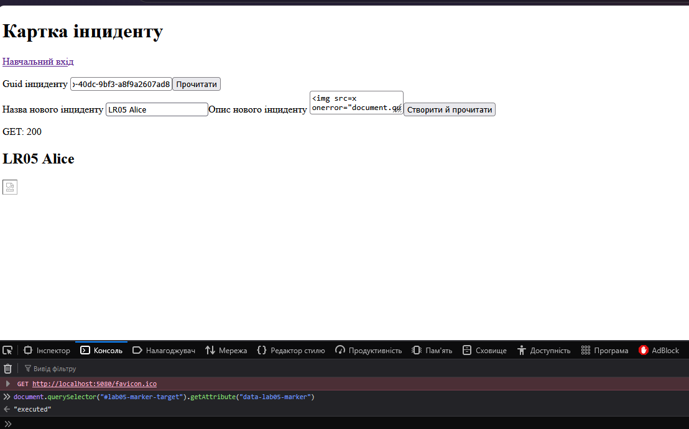

*Рисунок 1. Опис до виправлення. Після читання запису контрольний атрибут отримав значення executed.*

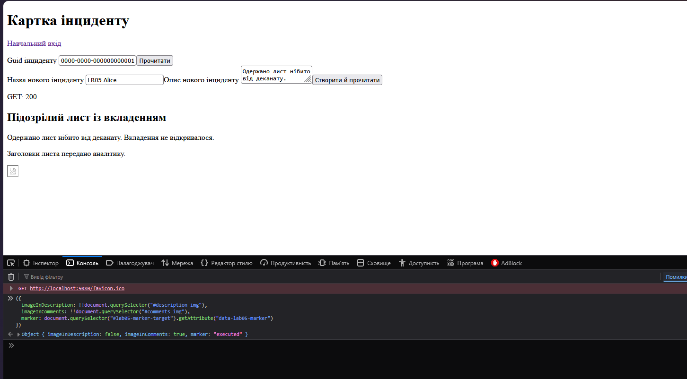

*Рисунок 2. Маркер у коментарі. Зображення з’явилося лише в блоці коментарів.*

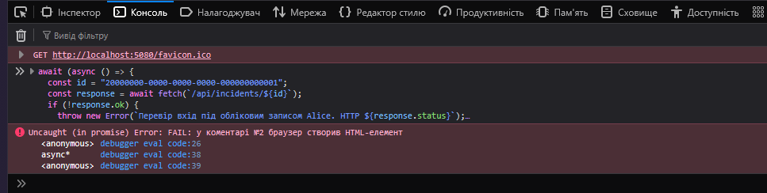

*Рисунок 3. DOM-тест до виправлення виявив HTML-елемент у коментарі №2.*

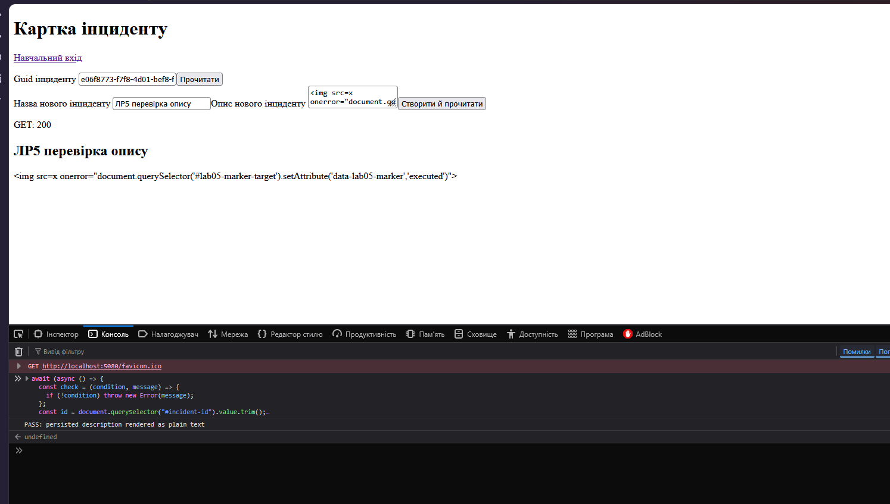

*Рисунок 4. DOM-тест опису після виправлення пройдено. Маркер відображено як текст.*

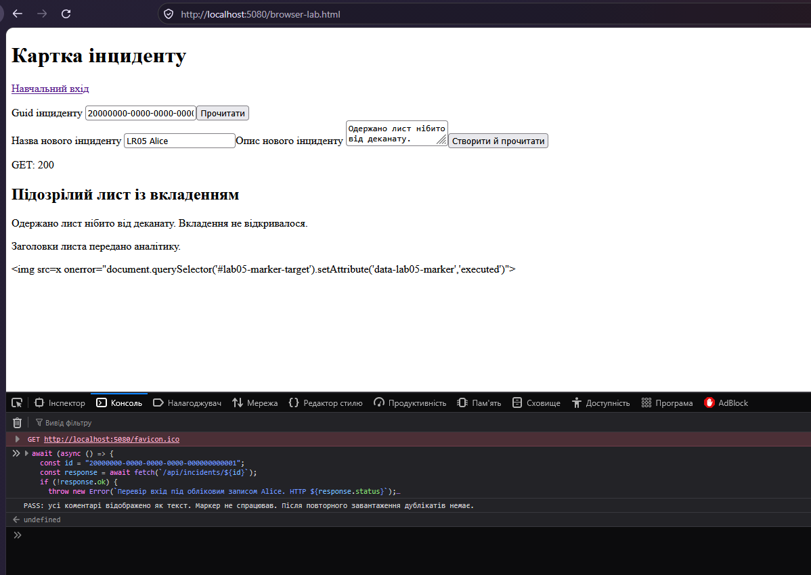

*Рисунок 5. DOM-тест коментарів після виправлення підтвердив збіг тексту та відсутність дублікатів.*

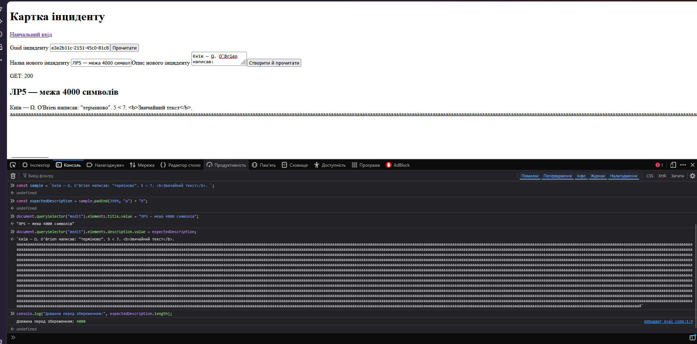

*Рисунок 6. Опис на межі довжини. Перед збереженням рядок містив 4000 символів.*

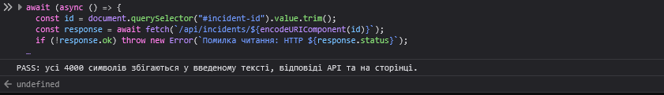

*Рисунок 7. Усі 4000 символів збіглися у введеному рядку, відповіді API та на сторінці.*

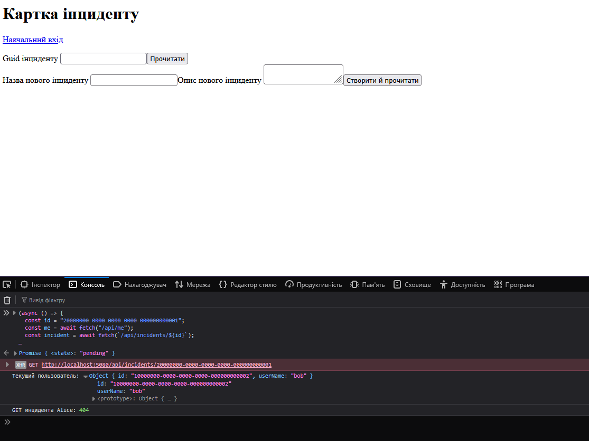

*Рисунок 8. Сеанс Bob підтверджено через /api/me. Запит до інциденту Alice повернув 404.*

### DOM-тест коментарів у Firefox

Увійти як Alice, відкрити `http://localhost:5080/browser-lab.html` та оновити сторінку. Виконати весь блок у консолі до натискання «Прочитати». Тест сам завантажує початковий інцидент Alice.

```javascript
await (async () => {
  const id = "20000000-0000-0000-0000-000000000001";
  const response = await fetch(`/api/incidents/${id}`);
  if (!response.ok) {
    throw new Error(`Перевір вхід під обліковим записом Alice. HTTP ${response.status}`);
  }

  const incident = await response.json();
  const expected = incident.comments.map(comment => comment.text);
  if (!expected.some(text => text.includes("data-lab05-marker"))) {
    throw new Error("В інциденті немає навчального коментаря з маркером");
  }

  const target = document.querySelector("#lab05-marker-target");
  if (target.hasAttribute("data-lab05-marker")) {
    throw new Error("Онови сторінку й запусти тест ще раз");
  }

  document.querySelector("#incident-id").value = id;

  for (let pass = 1; pass <= 2; pass++) {
    await load();
    const rows = [...document.querySelector("#comments").children];

    if (rows.length !== expected.length) {
      throw new Error(`FAIL: після завантаження №${pass} кількість коментарів відрізняється від відповіді API`);
    }

    for (const [index, row] of rows.entries()) {
      if (row.childElementCount !== 0) {
        throw new Error(`FAIL: у коментарі №${index + 1} браузер створив HTML-елемент`);
      }
      if (row.textContent !== expected[index]) {
        throw new Error(`FAIL: текст коментаря №${index + 1} відрізняється від збереженого`);
      }
    }

    await new Promise(resolve => setTimeout(resolve, 500));
    if (target.hasAttribute("data-lab05-marker")) {
      throw new Error("FAIL: під час відображення коментарів спрацював маркер");
    }
  }

  console.log("PASS: усі коментарі відображено як текст. Маркер не спрацював. Після повторного завантаження дублікатів немає.");
})();
```

На вразливому коміті `c56b7a6` тест зупинився під час першого завантаження, коли виявив HTML-елемент у коментарі №2. Після виправлення `2f3a436` той самий блок успішно перевірив обидва завантаження. [FAIL до виправлення](evidence/lab-05/lab5-3.png) · [PASS після виправлення](evidence/lab-05/lab5-5.png)

## REG-CORS-01. Запити з двох origin

Обидві навчальні сторінки запущено з каталогу `demonstrations/cors-probe` на портах `4173` і `4174`. Політика `Lab05BrowserProbe` діє лише в Development. Вона дозволяє точний origin `http://localhost:4173`, метод `GET`, заголовок `X-Lab-Cors-Probe` та запити з обліковими даними.

| Сценарій                                                             | Результат                                                                                                                                                                                                       |
| -------------------------------------------------------------------- | --------------------------------------------------------------------------------------------------------------------------------------------------------------------------------------------------------------- |
| Простий `GET /health` до налаштування                                | Firefox повідомив `CORS Missing Allow Origin`.                                                                                                                                                                  |
| Простий `GET /health` після налаштування                             | З `4173` JavaScript прочитав `{"status":"ready"}`. З `4174` браузер заборонив читання через відсутність `Access-Control-Allow-Origin`.                                                                          |
| Preflight з `4173`                                                   | `OPTIONS` повернув `204` і дозволив origin `4173`, метод `GET` та заголовок `X-Lab-Cors-Probe`. Основний `GET` повернув `200`.                                                                                  |
| Preflight з `4174`                                                   | `OPTIONS` повернув `204` без дозволеного origin. У Firefox рядок основного `GET` залишився без HTTP-статусу, передано 0 байтів.                                                                                 |
| Запит із `credentials: "include"` до ввімкнення `AllowCredentials()` | Для `/health` з `4173` сервер повернув `200` і дозволений origin, але Firefox повідомив `CORS Missing Allow Credentials`.                                                                                       |
| Захищений `GET /api/incidents`                                       | Після входу Alice сторінка на `4173` прочитала `200` і список інцидентів. Без входу вона прочитала `401`. На `4174` JavaScript не отримав доступу до відповіді.                                                 |
| Прямий запит через `curl.exe`                                        | `/health` повернув `200` для обох значень `Origin`. Для `4173` присутні `Access-Control-Allow-Origin: http://localhost:4173` та `Access-Control-Allow-Credentials: true`. Для `4174` обидва заголовки відсутні. |

Для повторення прямої перевірки у PowerShell:

```powershell
curl.exe -sS -D - -o NUL -H "Origin: http://localhost:4173" "http://localhost:5080/health"
curl.exe -sS -D - -o NUL -H "Origin: http://localhost:4174" "http://localhost:5080/health"
```

**Висновок.** Для простого запиту API може повернути `200`, навіть коли JavaScript сторінки не має права прочитати відповідь. Для запиту з нестандартним заголовком браузер спершу перевіряє дозвіл через `OPTIONS`. Окремо API перевіряє сеанс користувача та його право читати інцидент.

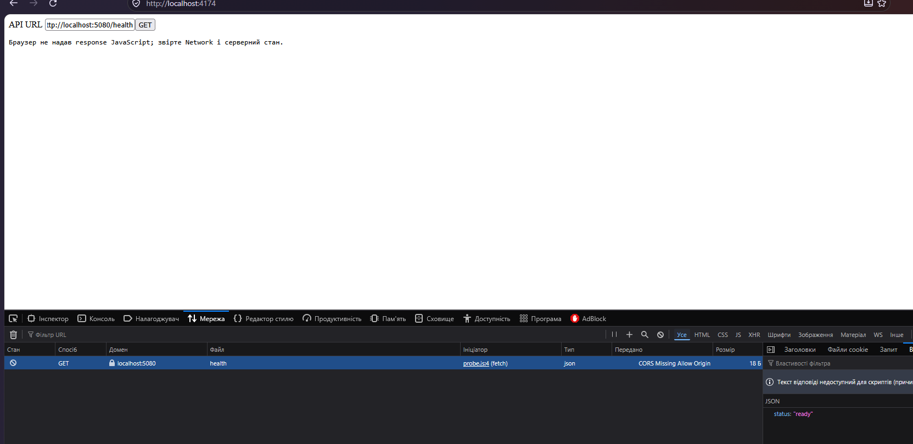

*Рисунок 9. Початковий запит з порту 4174. Браузер повідомив про відсутність дозволеного origin.*

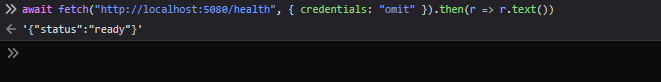

*Рисунок 10. Скрипт на дозволеному origin прочитав відповідь ready без облікових даних.*

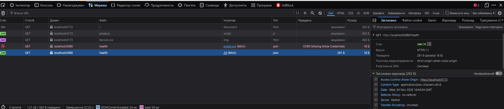

*Рисунок 11. Відповідь на простий GET містить статус 200 і дозволений origin localhost:4173.*

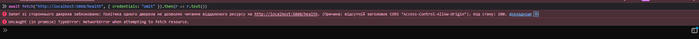

*Рисунок 12. Для простого GET з недозволеного origin сервер повернув 200, але браузер заблокував читання.*

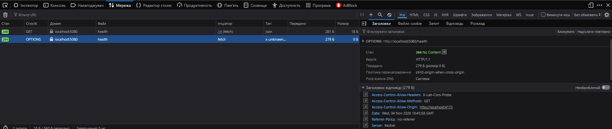

*Рисунок 13. Preflight для 4173. Відповідь OPTIONS дозволила GET і заголовок X-Lab-Cors-Probe.*

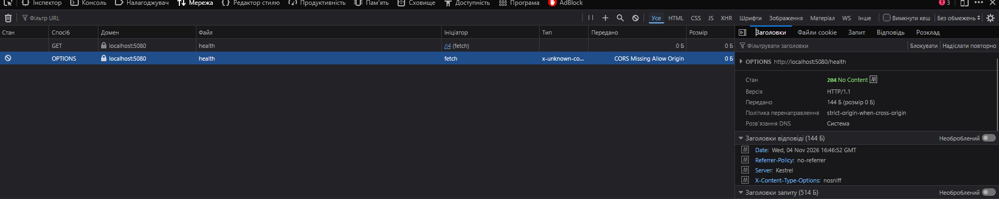

*Рисунок 14. Preflight для 4174. Відповідь OPTIONS не містить дозволу, для основного GET передано 0 байтів.*

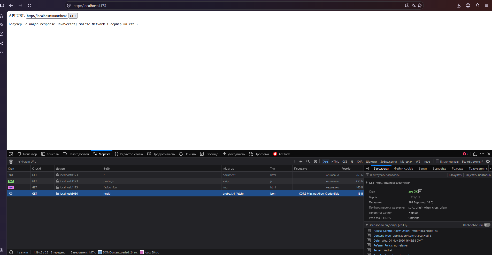

*Рисунок 15. До ввімкнення AllowCredentials сторінка 4173 не змогла прочитати відповідь на GET /health з обліковими даними.*

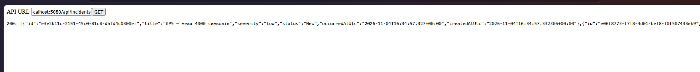

*Рисунок 16. Після входу захищений маршрут /api/incidents повернув 200 і список інцидентів.*

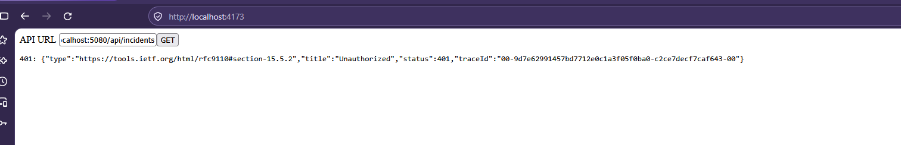

*Рисунок 17. Без входу сторінка 4173 прочитала відповідь 401 від захищеного маршруту.*

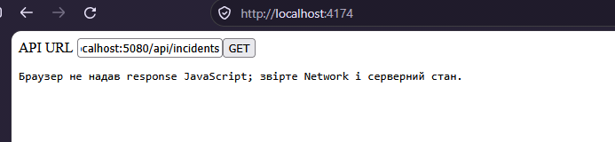

*Рисунок 18. На сторінці 4174 браузер заборонив читати відповідь на запит до /api/incidents.*

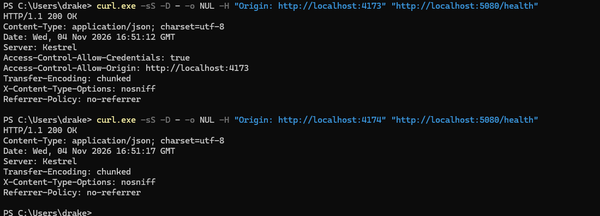

*Рисунок 19. Прямі запити curl.exe отримали 200 для обох origin. Дозвільні заголовки присутні лише для 4173.*

**Контрольний дослід із захищеним маршрутом**

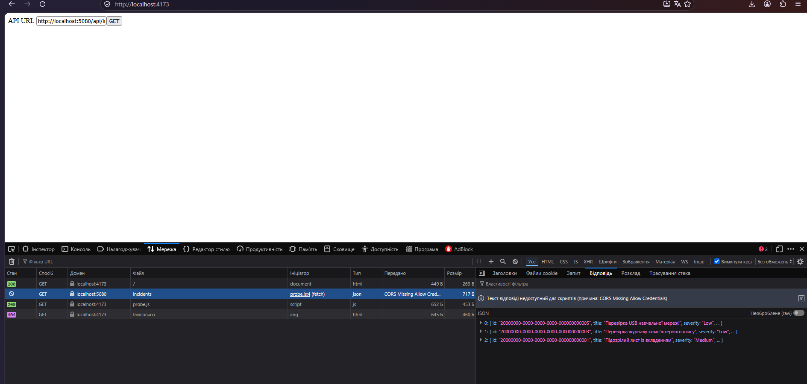

*Рисунок 24. Без AllowCredentials() Firefox отримав відповідь зі списком інцидентів, але заблокував її читання скриптом із localhost:4173 (CORS Missing Allow Credentials).*

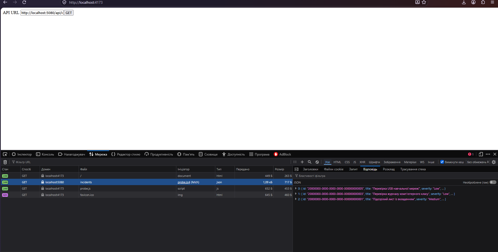

*Рисунок 25. Після відновлення AllowCredentials() запит із того самого origin до /api/incidents повернув 200. У мережевій панелі видно список інцидентів.*

## CSP, заголовки та контексти виведення

| Перевірка             | Фактичний результат і призначення                                                                                                                                                                                                                   |
| --------------------- | --------------------------------------------------------------------------------------------------------------------------------------------------------------------------------------------------------------------------------------------------- |
| CSP Report-Only       | Документ `/` повернув `Content-Security-Policy-Report-Only`. Спроба завантажити `http://localhost:4173/x.png` спричинила попередження з позначкою `Report-Only`.                                                                                    |
| CSP enforcement       | Після переходу на `Content-Security-Policy` та сама спроба завантажити `x.png` спричинила повідомлення Firefox про блокування за `default-src 'self'`.                                                                                              |
| Джерела ресурсів      | Основний клієнт завантажує JS, CSS і дані API зі свого origin. Для `script-src`, `style-src`, `connect-src` та `img-src` у цій політиці діє `default-src 'self'`. Вбудовані стилі головної сторінки та форми входу перенесено в локальні CSS-файли. |
| Вбудовування сторінки | `frame-ancestors 'none'` забороняє вбудовування клієнта у фрейм. Цю директиву задано окремо.                                                                                                                                                        |
| Інші заголовки        | `X-Content-Type-Options: nosniff` обмежує визначення MIME-типу браузером. `Referrer-Policy: no-referrer` запобігає передаванню адреси сторінки в заголовку `Referer`. Обидва заголовки видно у відповіді документа.                                 |
| URL та атрибут        | `safe-url.js` прийняв HTTPS-адресу й локальний відносний шлях. Обидва варіанти `javascript:` і некоректна адреса повернули `null`. Створене посилання мало перевірений `href`, а атрибут `onclick` був відсутній.                                   |

**Залишковий ризик.** Спільна функція `renderText()` захищає текстові вузли у двох перевірених місцях. Для URL потрібна окрема перевірка протоколу, а користувацькі рядки не можна вставляти у JavaScript-обробники. Дозволений скрипт, зокрема стороння бібліотека, розміщена на власному origin, працює з правами сторінки. Виняток для довідника `/scalar` обмежено середовищем Development.

**Автоматичні тести.** На окремій БД `securelab_lr05_tests` виконано `dotnet test` для `SecureLab.Api.Tests` у конфігурації Release. Успішно **91 із 91**, збоїв і пропущених тестів — **0**, тривалість тестів — **14,6 с**.

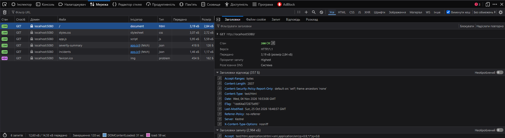

*Рисунок 20. Документ повернув CSP у режимі Report-Only, а також заголовки nosniff і no-referrer.*

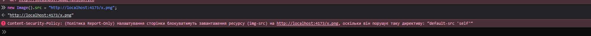

*Рисунок 21. У режимі Report-Only Firefox повідомив про порушення під час завантаження x.png.*

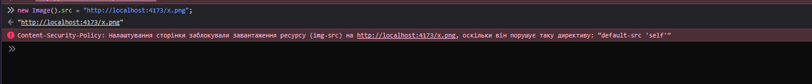

*Рисунок 22. У режимі enforcement Firefox заблокував завантаження того самого x.png.*

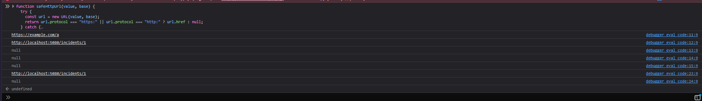

*Рисунок 23. Перевірка safe-url.js. Допустимий href встановлено, небезпечні схеми відхилено, атрибут onclick відсутній.*

**Підсумковий прохід під CSP.** Під час ручної перевірки підтверджено роботу входу, картки інциденту та навчальної сторінки браузера. Головний документ повернув HTTP 200 із заголовком `Content-Security-Policy`.

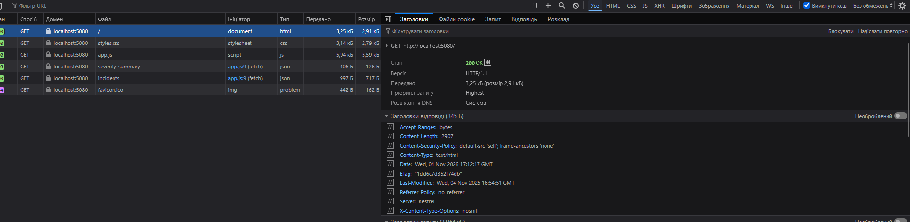

*Рисунок 26. Firefox отримав політику блокування для документа /, а також заголовки Referrer-Policy та X-Content-Type-Options.*
