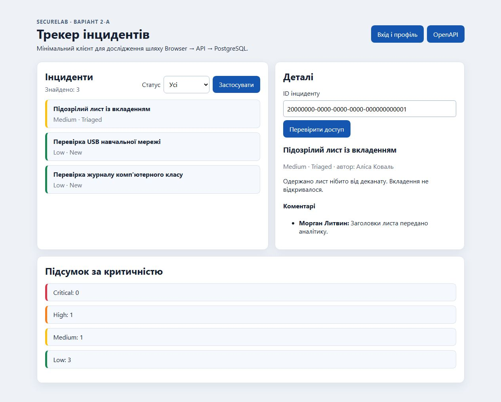
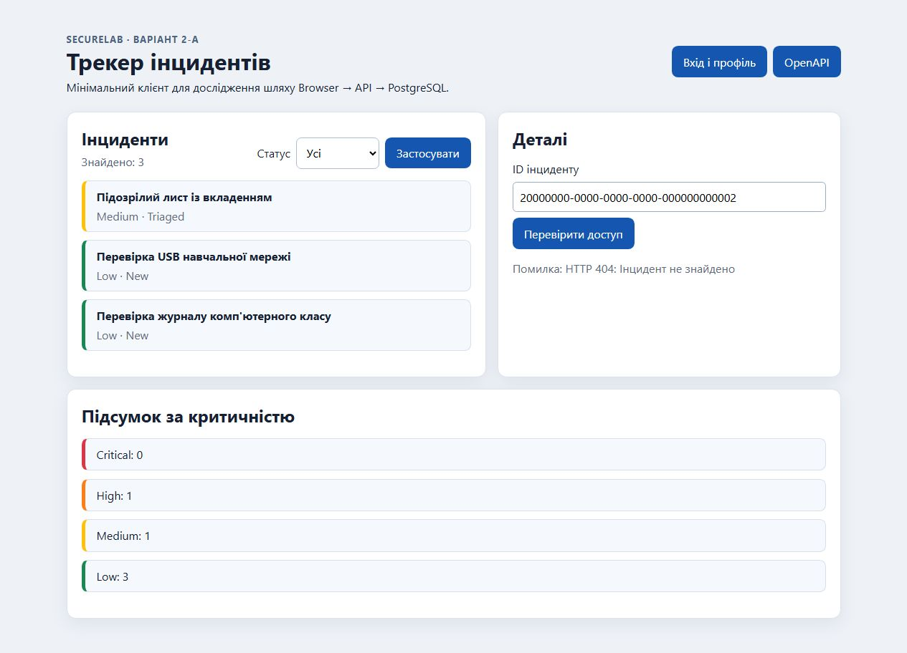

# Звіт до лабораторної роботи № 4

**Тема:** Авторизація, ролі, володіння ресурсом та IDOR/BOLA.
**Виконав:** Орленко Сергій. **Група:** КБ-41.
**Обраний рівень:** «Добре». **Baseline:** 2-A, трекер інцидентів SecureLab.
**Дата перевірки:** 22.10.2026, Europe/Kyiv. У машинних доказах час записаний у UTC.

## 1. Мета і межі

Перевірити право конкретного користувача на конкретний Incident, усунути
горизонтальний IDOR читання/зміни, обмежити список і дочірні коментарі,
захистити дію Analyst від Reporter та перевірити відмову без зміни даних.
Головна action - details/read; для «Добре» додатково перевірено update/delete.

Усі дії виконані на localhost зі штучними обліковими записами Alice, Bob,
Morgan та Admin. Для перевірок створено окрему БД `securelab_lr04_verify`;
дані основної БД `securelab` не скидалися. Значення паролів, cookies,
connection strings і повні журнали до доказів не включені.

Реалізація та перевірки готові. **DEL-02 поки не завершено:** створення
локального комміту було відхилено користувачем; vulnerable/fixed commits,
їхні hashes і тег `v0.4.0` не створено. Цей звіт не заявляє повної готовності
Git-частини до подання.

## 2. Початковий стан і середовище

| Параметр                           | Фактичне значення                                          |
| ---------------------------------- | ---------------------------------------------------------- |
| Гілка                              | `lab/4-authorization`                                      |
| Початковий тег                     | `v0.3.0`                                                   |
| Commit тега v0.3.0 і поточний HEAD | `c5e22f62f7acddd2bd17e2f1a1a89f44a7243f16`                 |
| Робоче дерево на початку           | Вже містило незакомічені заготовки ЛР 4; вони доповнені    |
| ОС / SDK                           | Windows, .NET SDK 10.0.401; net10.0                        |
| База                               | PostgreSQL 18.4 у локальному Docker, окрема перевірочна БД |
| API                                | `http://localhost:5080`                                    |
| Автентифікація                     | ASP.NET Core Identity, cookie, verified principal          |
| Підсумкові автоматичні тести       | 91 passed, 0 failed, 0 skipped; 30 сценаріїв ЛР 4          |

Наявні authentication tests ЛР 3 пройшли разом із підсумковим набором.
Перед фінальним прогоном виконано reset/seed тільки перевірочної БД.
Локальний TRX збережений у `tmp/lab04/lab04.trx`; до подання підготовлено
компактний результат без повного журналу: [summary.json](evidence/lab-04/summary.json).

## 3. Матриця та серверне рішення

Повна матриця - [access-matrix.md](access-matrix.md).

Reporter читає список і деталі власних інцидентів, змінює їхні title/description
та видаляє лише власні New. Analyst читає інциденти для аналізу і бачить
internal comments, але не має права довільно змінювати content чи видаляти.
Його привілейована дія - лише New → Triaged. Administrator не отримує
предметних прав автоматично через назву ролі. Protected create успадковано
з ЛР 3: owner визначає сервер.

`IncidentSubject.TryRead` бере Guid з `ClaimTypes.NameIdentifier`, а ролі -
з verified principal. Клієнтські body/query/headers не визначають subject.
`IncidentAccess` централізує правила Visible, Read, Update, Delete, Triage.
`IncidentQueries` застосовує query scoping до list/details до DTO-проєкції.
Mutations перевіряють ресурс перед присвоєнням полів і SaveChangesAsync.

Для чужого або неіснуючого Incident обрано однаковий 404 Problem Details
без identifier і приватного тексту. Для забороненої дії над видимим ресурсом - 403. Anonymous отримує 401 без redirect. Некоректний JSON/зайві поля DTO
отримують 400 незалежно від існування ресурсу.

## 4. Finding: IDOR у читанні та зміні Incident

**Передумова:** Alice увійшла як Reporter; відомий штучний id інциденту Bob
`20000000-0000-0000-0000-000000000002`.

**До:** у контрольованому локальному стані details шукали Incident тільки
за id; update завантажував ресурс за id та змінював title/description без
перевірки права на цей ресурс. Захист від anonymous і перевірка principal
залишалися ввімкненими. Точна різниця станів -
[lab-04-before.patch](../tests/http/lab-04-before.patch).

**PoC:** [before.json](evidence/lab-04/before.json), 9/9 перевірок:
Alice → Bob GET повернув 200, PUT повернув 204. Наступне читання Bob
підтвердило збереження чужої зміни. Скрипт повернув title/description Bob
у попередній стан і порівняв публічну відповідь. Після експерименту seed
перевірочної БД відновлено, включно зі службовим часом.

**Першопричина:** authentication підтверджувала особу, але пошук за UUID
не перевіряв право цієї особи на об'єкт. UUID не замінює authorization.

**Вплив:** розкриття чужого опису і коментарів та порушення цілісності
title/description через підстановку identifier.

**Виправлення:** details використовує дозволену множину IncidentAccess.Visible;
update перевіряє Read і Update до зміни полів. Delete перевіряє owner та New;
child endpoint спочатку перевіряє доступ до parent Incident, потім internal rule.

**Після:** [fixed.json](evidence/lab-04/fixed.json), 33/33 перевірки.
Alice → Bob GET/PUT/DELETE повертають 404; стан Bob до/після відмов однаковий.
Alice читає власний ресурс (200), змінює власний тестовий (204) та видаляє
власний New (204). Morgan читає Alice для аналізу (200).

**Залишковий ризик:** ownership-scoping search і severity-summary не виконано,
бо це A-11 рівня «Відмінно». На цих шляхах залишається ризик розкриття даних
або агрегатів; глобальне приховування ресурсу через усі маршрути не заявляється.
CSRF для cookie mutations і конкурентні переходи статусу також лишаються
поза виконаним обсягом. Навчальний результат не є заявою production readiness.

## 5. Доказова таблиця

Позначення: **HTTP** - [fixed.json](evidence/lab-04/fixed.json),
**TEST** - [summary.json](evidence/lab-04/summary.json), секція `tests.lab04`.
Усі рядки нижче мають фактичні результати, крім явно виключених A-08a/A-11.

| ID    | Рівень       | Сценарій                       | Передумови                          | Дія                                                            | Очікувано                                                 | Фактично                                                                                                | Доказ                                                                                           |
| ----- | ------------ | ------------------------------ | ----------------------------------- | -------------------------------------------------------------- | --------------------------------------------------------- | ------------------------------------------------------------------------------------------------------- | ----------------------------------------------------------------------------------------------- |
| A-01  | Добрий       | Anonymous                      | Без cookie                          | GET list/details/child, PUT, DELETE, POST triage               | 401 без redirect                                          | 401 для всіх 6 маршрутів; Location відсутній                                                            | TEST `A01_AnonymousGets401`; HTTP `A01-anonymous`                                               |
| A-02  | Достатній    | Власний ресурс                 | Alice, власний Incident             | Read; create/update/delete New fixture                         | Allow                                                     | GET 200, create 201, update/delete 204; зміна збережена, видалення підтверджене                         | TEST `A02_OwnerReadsUpdatesAndDeletesOwnNewIncident`; HTTP `owner-*`                            |
| A-03  | Достатній    | Чужий read                     | Alice, Bob Incident                 | GET з чужим id                                                 | 404 без приватних полів                                   | 404; немає id/description/comments                                                                      | TEST `A03_NonOwnerReadDoesNotExposeForeignDetails`; HTTP `A03-foreign-read`                     |
| A-03R | Entry ЛР 5   | Analyst read                   | Morgan, Alice Incident              | GET details                                                    | 200 для аналізу                                           | 200, правильний id                                                                                      | TEST `A03R_AnalystReadsAliceDetails`; HTTP `A03R-analyst-read`                                  |
| A-04  | Добрий       | Чужі mutations                 | Alice, Bob Incident                 | PUT та DELETE                                                  | 404, стан без змін                                        | Обидва 404; DB snapshot та публічні details без змін                                                    | TEST `A04_ForeignUpdateAndDeleteDoNotChangeState`; HTTP `A04-*`                                 |
| A-05  | Добрий       | List scoping                   | Alice                               | GET list                                                       | Лише власні                                               | 200; Bob відсутній, усі повернені id належать Alice                                                     | TEST `A05_ListContainsOnlyAllowedOwners`; HTTP `A05-*`                                          |
| A-06  | Добрий       | Вертикальне підвищення         | Reporter, власний New               | POST triage                                                    | 403, стан без змін                                        | 403; status та інші поля snapshot не змінилися                                                          | TEST `A06_ReporterCannotTriage_AndStateIsUnchanged`; HTTP `A06-*`                               |
| A-07  | Добрий       | Дозволений transition          | Morgan, New fixture Alice           | POST triage, повтор, PUT, DELETE                               | Лише New → Triaged                                        | 204; рівно 1 history row Morgan; повтор/редагування/видалення 403, стан незмінний                       | TEST `A07_AnalystTriagesOnlyNew_WithoutContentUpdateRights`                                     |
| A-08a | Альтернатива | Ігнорування зайвого поля       | Обрано Disallow                     | Не застосовується                                              | Виконати A-08b                                            | Не застосовується: обрано A-08b                                                                         | UpdateIncidentRequest                                                                           |
| A-08b | Добрий       | Overposting                    | Alice, власний fixture              | PUT з ownerUserId, role, status, severity, id або createdAtUtc | 400, захищений стан незмінний                             | Усі 6 варіантів 400; owner/status/severity/content/time і Identity roles без змін                       | TEST `A08b_OverpostingIsRejected_ProtectedStateAndRolesUnchanged`; HTTP `A08b-*`                |
| A-09  | Добрий       | Audit denied privileged action | Reporter отримав deny triage        | Зіставити подію і response traceId                             | Безпечна подія, той самий trace                           | authorization.denied; subject/action/resource/result/UTC/trace, trace збігається                        | TEST `A09_DeniedTriage_RecordsSafeEventWithResponseTrace`; summary `audit_events`, `live_audit` |
| A-10  | Добрий, 404  | Однаковий контракт відмови     | Той самий Alice client              | Чужий/неіснуючий id для GET/PUT/DELETE/triage/child            | Однакові status, Content-Type, body без traceId/requestId | Усі 5 пар 404; Content-Type і стабільне тіло однакові                                                   | TEST `A10_ForeignAndMissingHaveSame404`; HTTP зберігає обидві read-відповіді                    |
| A-11  | Відмінний    | Search/severity-summary        | Обрано «Добре»                      | Не виконувалося                                                | Поза рівнем                                               | Не виконувалось - рівень «Добре»                                                                        | Залишковий ризик у §4                                                                           |
| A-12  | Добрий       | Child/internal                 | Alice та Morgan, comments Bob/Alice | Direct child + details projection                              | Parent authorization; Reporter не бачить internal         | Alice 404 для чужого й internal; Morgan 200; internal відсутній у Reporter details, присутній у Analyst | TEST `A12_ChildAndInternalVisibilityFollowParentPolicy`; HTTP `A12-*`                           |

Додатково пройдено тести Bob → Alice із підробленим X-Demo-UserId,
відсутності bypass для Administrator, заборони owner delete для non-New
та читання публічного comment Bob аналітиком.

## 6. DTO, статус і аудит

`UpdateIncidentRequest` містить тільки title/description та має
`JsonUnmappedMemberHandling.Disallow`. Під час першого прогону 76/77 тестів
пройшли; overposting повертав 500 у Development. Причина - стандартне
ThrowOnBadRequest у Minimal API разом із exception middleware. У Program.cs
явно встановлено `RouteHandlerOptions.ThrowOnBadRequest = false`: порушення
DTO лишається 400. Після розширення й повтору тестів - 91/91.

Triage бере поточний status із БД, перевіряє Analyst та New. Успіх змінює
status на Triaged і додає history row із ChangedByUserId Morgan. Reporter
не отримує це право лише через ownership.

Безпечний фрагмент реального HTTP audit:

```text
authorization.denied
subject=10000000-0000-0000-0000-000000000001
action=triage
resource=20000000-0000-0000-0000-000000000001
result=denied
at=2026-10-21T21:14:56Z
trace=00-af45a79fb590de1c5bb567f73c27e430-9000b38ede55ed09-00
```

Це структуроване представлення вибраних полів події; оригінальний рядок
є в summary.live_audit. Trace такий самий, як fixed.audit_trace_id.
Паролі, cookies, token, приватний текст і raw body до події не включаються.

## 7. Browser client

На auth-lab.html виконано login Alice і підтверджено її id.
На головній сторінці введено власний id: показано власні details та публічний
коментар. Потім у тому самому сеансі змінено лише id на Bob: показано
«Помилка: HTTP 404: Інцидент не знайдено», попередні details прибрано.





`app.js` показує дані через textContent/createTextNode; innerHTML відсутній.
Поле ID дозволяє демонструвати підстановку identifier, але рішення ухвалює
API. Кнопка чи клієнтська перевірка не є засобом authorization.

## 8. Повторення перевірок

Виконувати з кореня проєкту. Python-команди нижче можна запускати через
`py -3` або наявний Python. Пароль задайте поза файлами проєкту:

```powershell
$studySecret = Read-Host 'Пароль локальних навчальних користувачів' -AsSecureString
$env:SeedUsers__Password = [Net.NetworkCredential]::new('', $studySecret).Password
Remove-Variable studySecret
```

Для окремої БД налаштуйте `ConnectionStrings__SecureLab` поза Git. У цій
перевірці використано `securelab_lr04_verify`. Reset очищає обрану БД;
застосовуйте його лише до навчальних даних, які потрібно повернути до seed.

```powershell
docker compose --env-file infra/.env.example -f infra/compose.yaml up -d --wait
dotnet run --project src/SecureLab.Api -- --reset-database
dotnet test tests/SecureLab.Api.Tests/SecureLab.Api.Tests.csproj --configuration Release --logger "trx;LogFileName=lab04.trx" --results-directory tmp/lab04
dotnet run --project src/SecureLab.Api --configuration Release --launch-profile http
```

В іншому терміналі з тим самим seed password:

```powershell
py -3 scripts/check-lab04.py --phase fixed
py -3 scripts/lab04-results.py
```

Для повторення контрольованого PoC зупиніть API, виконайте
`py -3 scripts/lab04-state.py before`, запустіть API зі складанням та
`check-lab04.py --phase before`. Після цього зупиніть API, виконайте
`py -3 scripts/lab04-state.py fixed`, відновіть навчальний seed і повторіть
tests та fixed HTTP. Helper змінює тільки два файли за patch, не створює
commits/tags і не перемикає гілку. Підсумкове робоче дерево зараз у fixed state.

Для ручного клієнта є [lab-04-access.http](../tests/http/lab-04-access.http).
Сценарій A-07 із New fixture та історією виконується автоматичним тестом;
seed Incident Alice уже Triaged і не є позитивним fixture для переходу.

## 9. Git і склад подання

| Артефакт                            | Статус                                                      |
| ----------------------------------- | ----------------------------------------------------------- |
| Матриця, код, regression tests      | Готово, перевірено                                          |
| HTTP «до/після», audit, screenshots | Збережено в evidence/lab-04                                 |
| DEL-01: звіт                        | Підготовлено; автору потрібно прочитати й пояснити рішення  |
| Vulnerable commit hash              | Відсутній: створення комміту відхилено користувачем         |
| Fixed commit hash                   | Відсутній: перевірене рішення залишається в робочому дереві |
| DEL-02: v0.4.0 та передача історії  | Не завершено; тег і remote/MR для ЛР 4 не створювалися      |
